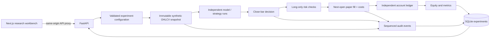

# Architecture

Patrick begins as a modular research application with a functioning event-based
replay engine. The boundaries below are logical modules in milestone 1; NATS,
live market ingestion, and distributed workers are planned, not active services.

## Fair comparison

An experiment chooses one axis. Model comparison fixes a single strategy;
strategy comparison fixes a single model. Initial cash, symbol, dataset, seed,
bar count, and transaction costs remain identical. Each run receives its own
account state, while the immutable candle sequence is common. Strategy content
and data hashes travel with the export. Random run IDs and creation timestamps
are operational metadata, not inputs to the financial simulation.

Signals see only data through the current candle close. An order generated at
that close can first fill at the following candle's open. An unfillable final
signal cannot create a trade. Slippage and fees are explicit costs, with no
borrowing or shorting. These are research execution assumptions, not a model of
exchange order queues, market impact, or a particular broker's fill guarantees.

## Local storage and concurrency

The API stores each completed experiment and its audit record together. Replay
is bounded and synchronous for local development. A single-user process is the
supported starting deployment. Do not scale out by adding workers over a shared
SQLite file; use a transactional database and persistent task scheduler first.

The API is reachable directly on loopback during local development. Browsers
call the Next.js same-origin proxy; credentials and provider requests belong on
the API server. The default application has no user authentication and should
remain on loopback or a private development network. The container configuration
binds published ports to loopback by default.

## Evolving to the target architecture

`ticks.raw → candle.closed.1m → strategy.signal → order.intent → paper.fill`
becomes the versioned NATS subject pipeline when live feeds and workers arrive.
Publishing requires an outbox tied to the ledger transaction. Delivery can be
at least once; processing must be idempotent. Stream retention, replay, consumer
acknowledgements and poison messages need explicit policies. Exchange timestamps,
receipt timestamps, model deadlines and trace IDs remain distinct.

PostgreSQL owns experiment configuration, immutable strategy versions, accounts,
orders, fills and audit. TimescaleDB can partition market data in the same
operational stack. Redis is optional, justified by measured cache/coordination
needs rather than required for correctness. Authentication and tenant boundaries
must precede exposing any mutation endpoint publicly.

See [implementation-plan.md](implementation-plan.md) for milestones and acceptance
criteria, and [api-contract.md](api-contract.md) for the current HTTP contract.
